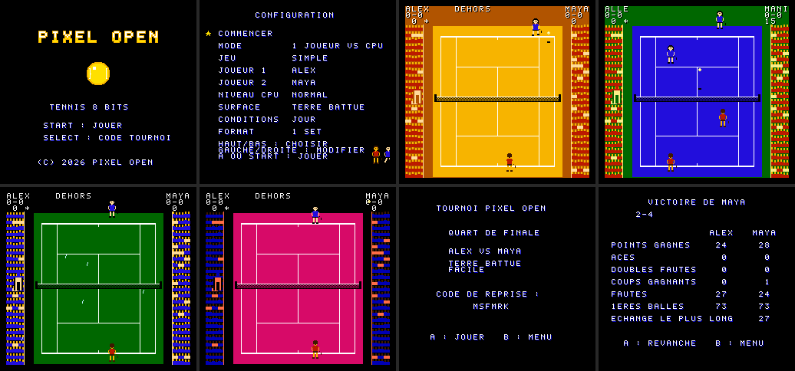

# Pixel Open

Jeu de tennis 8 bits original pour **NES / Famicom** (NTSC et PAL) : simple et double, 1 ou 2 joueurs, IA à trois niveaux, quatre surfaces, jour, nuit et pluie, tournoi avec codes de reprise, entraînement.



## Jouer

ROM prête à lancer : [`dist/pixel_open.nes`](dist/pixel_open.nes) (iNES, mapper 0). Elle se lance dans un émulateur NES ou sur console via une cartouche flash.

Commandes de base :
- **Croix** : se déplacer ;
- **A** (maintenir puis relâcher) : frappe liftée, plus ou moins puissante ;
- **B** : coupé ;
- **+ HAUT/BAS** : lob, amortie, frappe à plat, croisé court ;
- **START** : pause.

Le détail est dans le [manuel](docs/MANUEL.md).

## Documentation

- [Cahier des charges](CAHIER_DES_CHARGES.md)
- [Manuel du joueur](docs/MANUEL.md)
- [Documentation technique](docs/TECHNIQUE.md) : architecture, mapper, mémoire, physique, IA, audio, NTSC/PAL, optimisations
- [Rapport de réalisation](docs/RAPPORT.md) : conformité au CDC, tests, limitations

## Compiler et tester

Outils : `cc65` 2.19, `python3`, `make` ; pour les tests, `gcc` et `node` ≥ 18.

```sh
make          # build/pixel_open.nes
make test     # règles + codes (natif) et 62 vérifications sur émulateur (jsnes)
```

## Organisation

```
src/        code du jeu (C cc65 + assembleur 6502)
tools/      génération des graphismes, rapport d'occupation mémoire
assets/     CHR généré et aperçus
cfg/        carte mémoire ld65 (NROM-256)
tests/      tests unitaires, tests et profileur sur émulateur
docs/       manuel, documentation technique, rapport, captures
dist/       ROM finale
```

## État

Version 1.0, jouable et testée **en émulation uniquement**. Les tests sur consoles réelles et plusieurs éléments du CDC (replays, formats championnat/saison, IA adaptative…) restent à faire : voir le [rapport](docs/RAPPORT.md).
