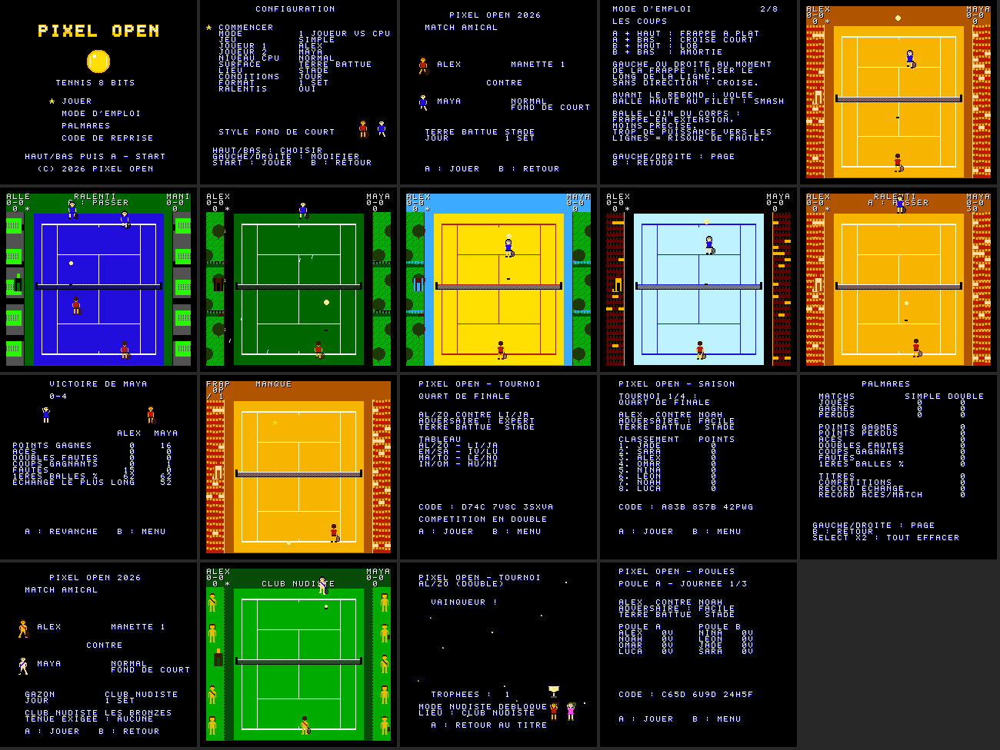
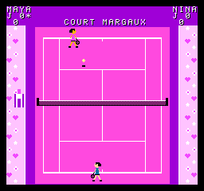

# Royal Martinot — Manuel du joueur

Royal Martinot est un jeu de tennis 8 bits original pour NES et Famicom. Il se joue seul contre l'ordinateur ou à deux, en simple comme en double, en match, en compétition ou à l'entraînement.

Ce manuel est aussi intégré au jeu : à l'écran titre, choisissez **MODE D'EMPLOI** (8 pages ; GAUCHE/DROITE pour changer de page, B pour revenir).

## 0. Générique de lancement

À l'allumage, un générique d'une trentaine de secondes rappelle à tous l'importance de l'événement… et tourne un peu mal. La fanfare commence majestueuse, puis déraille : fausses notes, accélération, arpèges affolés, glissade jusqu'au grave, silence gêné et « pouet » final.
1. « BRUNO MARTINOT PRESENTS » ;
2. « IN ASSOCIATION WITH AUGUSTIN MARTINOT — CHIEF EXECUTIVE SON » ;
3. « A ROYAL MARTINOT PRODUCTION — FILMED IN GLORIOUS 8-BIT TECHNICOLOR » ;
4. « LOADING PRESTIGE… » : la barre de chargement monte à 99 %, hésite, puis grimpe à **117 %** et déborde de son cadre (« OVERLOAD ! ») ;
5. la critique : cinq étoiles, « MAGNIFIQUE. » (Bruno Martinot), « THE GREATEST TENNIS GAME EVER MADE IN THIS HOUSE. » (Augustin Martinot), « WINNER - BEST GAME 2026 (CATEGORY: OUR LIVING ROOM) » ;
6. les mentions légales : « NO TENNIS BALLS WERE HARMED DURING PRODUCTION », « RATED A FOR AUGUSTIN », « POWERED BY 1.79 MHZ OF PURE LUXURY », « OFFICIAL SPONSOR : THE FAMILY FRIDGE », « 0 % CALORIES » ;
7. la révélation du logo : chaque lettre géante tombe avec un « boum », l'or scintille, confettis… et l'ovation se réduit à un seul « *CLAP* ». Puis une balle de tennis fait tomber le N de MARTINOT ; le stagiaire arrive, s'excuse (« OOPS. SORRY. ») et le remet en place : « (PRESTIGE RESTORED) ».

**Passer le générique** : au premier bouton, le jeu se vexe (« ARE YOU SURE? THIS IS VERY PRESTIGIOUS. ») ; au second, il cède (« FINE. ») et l'écran titre apparaît. Le réglage SON mémorisé s'applique dès le générique.

## 1. Écran titre

**HAUT/BAS** choisit une entrée et **A** la valide. **START** ouvre directement la configuration.

| Entrée | Rôle |
|---|---|
| JOUER | Configuration de la partie |
| MODE D'EMPLOI | Les commandes et les règles, dans le jeu |
| PALMARÈS | Statistiques cumulées, titres, historique, records |
| CODE DE REPRISE | Reprendre une compétition avec son code |

Sans action pendant 20 secondes, une démonstration démarre (alternativement en simple et en double). **A** ou **START** rend la main.

## 2. Configuration

**HAUT/BAS** choisit une ligne, **GAUCHE/DROITE** change la valeur. **START** lance la partie, **B** revient au titre. Les lignes affichées dépendent du mode. Tout le contenu est disponible dès le départ.

| Ligne | Choix |
|---|---|
| MODE | 1 joueur contre CPU · 2 joueurs adversaires · En équipe · Compétition · Entraînement · Démo |
| JEU | Simple · Double (en mode 2 joueurs adversaires seulement : contre le CPU, le simple est la règle, et le double avec un partenaire CPU est le mode En équipe) |
| JOUEUR 1 / JOUEUR 2 | 17 personnages (8 hommes, 9 femmes, dont **Margaux**), chacun avec son style de jeu. En compétition de double, JOUEUR 2 devient PARTENAIRE |
| NIVEAU CPU | Facile · Normal · Expert |
| SURFACE | Terre battue · Gazon · Dur · Moquette · Plage · Glace (les deux dernières sont des terrains fantaisie) |
| LIEU | Stade (tribunes pleines) · Club (extérieur, arbres) · Salle (intérieur) · Club nudiste (bonus à débloquer, voir § 9 bis ; panneau « BRONZES » à côté du score) · Court Margaux (court rose, décor de cœurs, fleurs et étoiles, petit panneau « MARGAUX » à côté du score) |
| CONDITIONS | Jour · Nuit · Pluie. Il ne pleut pas en salle : la pluie y devient « jour » |
| FORMAT | 1 set · 3 sets · 5 sets · Rapide (sets de 4 jeux) |
| RALENTIS | Oui/Non : ralenti automatique après les plus beaux points |
| VITESSE JEU | Lent (75 %, idéal pour débuter ou pour les enfants) · Normal · Rapide (125 %). Aussi en compétition et à l'entraînement. En Lent, une petite croix montre une demi-seconde où va tomber la balle adverse |
| FATIGUE | Oui/Non. Au-delà de 10 frappes dans un échange, tous les joueurs (humains et CPU) ralentissent peu à peu, jusqu'à environ 20 % ; une goutte de sueur clignote au-dessus d'eux. Tout redevient normal au point suivant. Pas de fatigue à l'entraînement |
| SON | Musique + sons · Bruitages seuls · Aucun. L'écran titre et le menu partagent une petite polka de cirque, sautillante et ridicule : « Bruitages seuls » la fait taire |

Les réglages du menu sont **mémorisés** au lancement de chaque partie. Sur une cartouche à pile, ils sont retrouvés au prochain allumage ; le palmarès n'est pas touché.

Selon le mode, d'autres lignes apparaissent :
- **Compétition** : type de compétition et, pour le tournoi personnalisé, le nombre de joueurs, la progression des adversaires et la variété des surfaces ;
- **Entraînement** : l'exercice et, pour l'exercice personnalisé, le côté, la vitesse, l'effet et le nombre de balles.

La ligne **STYLE** indique le style de jeu de l'adversaire choisi.

| Personnage | Style |
|---|---|
| Alex, Ines | Équilibré |
| Maya, Luca | Fond de court |
| Leon, Ivan | Puissance |
| Nina, Lina | Filet (service-volée) |
| Omar, Jade | Défensif |
| Zoé, Tom | Offensif |
| Hugo, Noah | Tactique (lobs, amorties) |
| Emma, Sara | Placement (précision) |
| **Margaux** | Fantaisie : varie tout, adore l'amortie et le lob, monte volontiers au filet. Cheveux longs, blonds et bouclés ; tenue rose clair, la seule de cette couleur, choisie pour rester visible sur tous les courts, y compris le sien. Elle ne joue jamais au club nudiste, et c'est toujours vous qui la choisissez : elle n'est jamais tirée au sort comme adversaire |

Avant chaque match, un **écran de présentation** rappelle l'épreuve, les joueurs, leur niveau et leur style, la surface, le lieu, les conditions et le format. **A** lance le match.

## 3. Commandes

### Pendant l'échange

| Commande | Action |
|---|---|
| Croix | Se déplacer sur toute sa moitié de court |
| **A** (maintenir puis relâcher) | Frappe liftée. Plus vous armez longtemps avant l'impact, plus la frappe est forte (et risquée) |
| **B** | Coup coupé (slice) : balle basse et lente |
| **A** + HAUT | Frappe à plat, longue et rapide |
| **A** + BAS | Croisé court, lifté |
| **B** + HAUT | Lob |
| **B** + BAS | Amortie |
| GAUCHE / DROITE à l'impact | Viser le long d'une ligne ; sans direction, le coup part croisé |
| **START** | Pause : CONTINUER ou QUITTER (HAUT/BAS puis A). SELECT quitte directement |

La frappe part toute seule quand la balle entre dans votre zone de frappe pendant que vous armez, ou juste après avoir relâché le bouton.

Le type de coup dépend aussi de la situation :
- balle prise avant le rebond : **volée** ;
- balle haute avant le rebond : **smash** ;
- balle très haute (lob un peu court), si vous êtes dans les deux tiers avant de votre moitié de court : **smash sauté**, le joueur saute et frappe plus fort et plus à plat (le CPU Expert sait aussi le faire) ;
- balle loin du corps : frappe en extension, moins précise ;
- **frappe parfaite** (lifté, à plat ou coupé, après le rebond) : la balle passe **à côté du corps**, ni collée ni en extension, et vous avez **relâché le bouton juste avant** qu'elle n'arrive (fenêtre de 3 images, 1/20 de seconde). La balle part environ 25 % plus vite, presque sans écart, avec un « tchak » sec et un petit éclat blanc près de la raquette. Si ce coup est gagnant, le bandeau annonce « COUP PARFAIT ! ». Si vous gardez le bouton enfoncé jusqu'à l'impact, la frappe reste normale. Ordre de grandeur pour un adulte : 15 à 20 % de vos coups au début, 30 à 40 % avec l'habitude. Le palmarès donne votre pourcentage.

### Au service

1. Placez-vous derrière la ligne de fond avec GAUCHE/DROITE.
2. **A** ou **B** lance la balle.
3. Au sommet du lancer, **A** frappe un service puissant, **B** un service coupé plus sûr.
   - Plus la frappe est proche du sommet, plus le service est précis.
   - GAUCHE/DROITE à l'impact vise l'extérieur ou le T.
   - Si vous ne frappez pas, la balle retombe et le lancer est à refaire, sans pénalité.
4. **Service canon** : **A** frappé **pile au sommet** du lancer, dans une fenêtre de 2 images (1/30 de seconde). La balle part environ 30 % plus vite et presque sans écart, avec le bandeau « SERVICE CANON », un « boum » et une petite traînée. Près du sommet, la balle ne bouge presque plus à l'écran : le canon se trouve au **rythme**, environ une demi-seconde après le lancer. En deuxième balle, il est un peu moins précis. Le CPU Expert en réussit parfois ; Facile et Normal jamais.
   - Ordre de grandeur pour un adulte : environ un service canon sur quatre au début, un sur trois à un sur deux avec l'entraînement.
   - Le palmarès compte vos services canon et leur pourcentage parmi vos services frappés avec A ; l'écran de résultats donne le nombre par match.

Le lancer reste visible quelle que soit votre position, y compris quand vous servez du haut de l'écran.

## 4. Règles

- Points 0, 15, 30, 40, égalité, avantage ; il faut deux points d'écart pour gagner le jeu.
- Sets de 6 jeux avec deux jeux d'écart ; **jeu décisif** en 7 points à 6-6 (à 4-4 en format rapide).
- Le service alterne à chaque jeu, du côté droit puis gauche.
- **Fautes** : deux fautes de service font une **double faute**. Un service qui touche la bande du filet puis tombe dans le bon carré est un **let** : il est à remettre, sans faute.
- Une balle qui touche la bande pendant l'échange et passe reste en jeu.
- **Changement de côté** après chaque jeu impair, tous les 6 points du jeu décisif, et en fin de set si le total de jeux est impair.
- **En double** :
  - les couloirs sont en jeu, sauf au service ;
  - les partenaires servent à tour de rôle ;
  - chacun reçoit de son côté (égalité ou avantage).

## 5. Affichage

- Les deux **panneaux de score** occupent les coins supérieurs, au-dessus des tribunes ; les joueurs ne peuvent pas les masquer.
  - Coin gauche : l'équipe qui joue en bas de l'écran ; coin droit : celle du haut.
  - Chaque panneau ne concerne qu'un joueur (ou une équipe) :
    - ligne 1 : le nom ;
    - ligne 2 : les jeux gagnés dans le set en cours (« J 3 »), suivis de `*` si ce joueur sert ;
    - ligne 3 : les points du jeu en cours (0, 15, 30, 40, AV), suivis d'un rond plein par set gagné.
- Les **annonces** de l'arbitre s'affichent au centre du bandeau : faute, let, égalité, avantage, balle de set ou de match, jeu décisif, changement de côté, ace, coup gagnant…
- Les **coups gagnants** sont nommés : SMASH SAUTÉ, SMASH, AMORTIE, LOB GAGNANT, VOLÉE GAGNANTE, PASSING (adversaire au filet) ou COUP GAGNANT, avec un bref « ting » ; sans autre son ajouté et toujours sans musique pendant le match.
- Sur le court : chaque joueur a une **ombre** (en double, seulement pendant un saut, car la NES n'affiche que 8 sprites par ligne). La balle soulève un peu de **poussière** en rebondissant sur la terre battue et le sable, et fait une **éclaboussure** sous la pluie. Dans tous les lieux, l'**arbitre de chaise** est assis de profil sur sa grande chaise blanche, à gauche du filet, tourné vers le court. Il tend le bras sur une faute ou une balle dehors, agite le bras sur un let et lève le bras en grand à la fin du match. Le bruit du rebond change selon la surface : sourd sur la terre, sec sur le dur, feutré sur le sable…
- **Récapitulatif du score** :
  - après chaque jeu, le bandeau affiche pendant 2 secondes le score set par set, une ligne par équipe : « ALEX 6 3 » / « MAYA 4 1 » (sets terminés, puis jeux du set en cours) ;
  - à la fin de chaque set, un écran fait le point : tableau des sets, vainqueur du set, statistiques du match jusque-là, joueur au service pour la suite, sur une petite musique d'interlude. **N'importe quel bouton** (manette 1 ou 2) ferme l'écran aussitôt et reprend le match, sans fondu ; sinon, reprise automatique au bout de 10 secondes. La musique s'arrête dès la reprise ;
  - en fin de match, l'écran des résultats commence par le tableau complet des sets.
- **Victoire** : quand vous gagnez le match, pendant « JEU, SET ET MATCH ! », votre joueur (et votre partenaire en double) **sautille de joie**, raquette levée, sous une **pluie d'étoiles et de confettis**, sur une **fanfare de victoire** qui dure toute la fête. Trois **feux d'artifice** partent : la fusée siffle en montant, fait « pop » et éclate en étoiles. Pas de fête quand c'est le CPU qui vous bat (petite mélodie triste à la place).
- Le **public** se lève et applaudit après les beaux points. Après un ace, un coup gagnant, une frappe parfaite gagnante ou un long échange, un **ralenti** rejoue le point (A pour le passer).
- **En fin de match** :
  - le vainqueur célèbre et le perdant baisse la tête ;
  - l'écran de résultats donne les statistiques : points gagnés, aces, doubles fautes, coups gagnants, fautes, pourcentage de premières balles, plus long échange ;
  - **A** relance une revanche, **B** revient au menu.

## 6. Surfaces, lieux et conditions

| Surface | Comportement |
|---|---|
| Terre battue (brique) | Rebond haut, balle ralentie : échanges longs |
| Gazon | Rebond bas, balle qui fuse : avantage au service-volée |
| Dur | Compromis équilibré |
| Moquette | Rapide et assez bas |
| Plage (fantaisie) | Sable : balle très lente, rebond très haut |
| Glace (fantaisie) | Balle qui file au ras du sol |

L'effet modifie aussi le rebond : le lifté rebondit plus haut, le coupé reste bas.

La balle grossit quand elle monte et rapetisse près du sol ; son ombre indique toujours où elle se trouve sur le court.

Les joueurs courent de profil quand ils se déplacent sur le côté, et l'on entend discrètement leurs pas.

Conditions :
- **Nuit** : décor assombri.
- **Pluie** : gouttes à l'écran, rebonds plus bas et balle qui glisse.

## 7. Modes

- **Match** : simple ou double, contre l'ordinateur ou à deux.
  - **En équipe** : toujours en double (la ligne JEU n'est pas proposée), contre deux joueurs CPU. PARTENAIRE choisit le personnage de votre coéquipier, et JOUE PAR décide qui le contrôle : l'ordinateur ou la manette 2.
  - **2 joueurs adversaires** : en double, chacun a un partenaire CPU.
- **Démo** : l'ordinateur joue seul.

### Compétitions

| Compétition | Déroulement |
|---|---|
| Tournoi | 8 joueurs, élimination directe : quart, demi, finale |
| Poules | 2 poules de 4 (3 journées). Les 2 premiers de chaque poule vont en demi-finales croisées, puis en finale |
| Championnat | 6 joueurs, toutes rondes (5 journées). Classement aux victoires, départage par confrontation directe |
| Saison | 4 tournois de 8 joueurs sur terre, gazon, dur puis moquette. Points : 45 (quart), 90 (demi), 150 (finale), 250 (victoire). Classement général à la fin |
| Personnalisé | 4 ou 8 joueurs ; adversaires de niveau fixe ou progressif ; même surface ou surface différente à chaque tour |

Toutes les compétitions se jouent **en simple ou en double** (ligne JEU) :
- en double, vous choisissez votre partenaire (ligne PARTENAIRE), puis qui le joue (ligne JOUE PAR) : l'ordinateur ou la **manette 2**. À deux joueurs humains, vous formez une seule équipe contre les équipes CPU ;
- les autres équipes sont tirées au sort parmi les 17 personnages, qui sont tous différents.

Quand vous gagnez une compétition, vous montez sur le **podium**, au centre de l'écran et sur le court de la compétition. Vous êtes sur la plus haute marche, le finaliste (ou le 2e du classement) à gauche, le 3e à droite, tous **en grand**. La coupe géante est brandie au-dessus de votre tête sous une pluie de confettis, sur la fanfare de victoire, pendant que **5 feux d'artifice** éclatent. Les noms sont écrits sous les marches. En double, vous montez à deux sur la plus haute marche ; pour les autres équipes, seul le capitaine monte, et le nom de l'équipe est écrit dessous. Ensuite, place au calme : l'écran reste affiché jusqu'à A.

L'écran d'étape montre le prochain adversaire (niveau, surface), le tableau ou le classement, et le **code de reprise**. Les matchs entre joueurs CPU sont simulés selon leur niveau.

### Entraînement

| Exercice | Contenu |
|---|---|
| Frappes / cibles | 20 balles ; 1 point par balle dans le court, 2 dans la zone de l'étoile |
| Déplacements | Balles alternées dans les deux coins |
| Régularité | Série sans faute la plus longue (jusqu'à 50) |
| Précision | Seule la zone désignée (fond ou court, gauche ou droite) rapporte des points |
| Volée | Vous êtes au filet ; balles tendues à volleyer |
| Service | 20 services ; bonus si le service tombe à l'extérieur ou au T |
| Joueur fixe | Échanges contre un adversaire immobile qui renvoie les balles au centre |
| Personnalisé | Côté (coup droit, revers, alterné, aléatoire), vitesse, effet (lifté, coupé, lob) et nombre de balles (10, 20, 30) |
| Tutoriel | Leçon guidée : frapper, amortie, lob, viser, servir |

Votre meilleur score de chaque exercice est conservé dans le palmarès.

À l'entraînement, chaque coup donne un **retour sur le timing**, pour apprendre le service canon et la frappe parfaite :
- au service frappé avec A : « SERVICE CANON », ou « TROP TÔT DE 3 IMAGES », « TROP TARD DE 1 IMAGE »… ;
- sur les coups lifté, à plat et coupé : « COUP PARFAIT ! », « TROP TÔT DE 2 IMAGES » (bouton relâché trop tôt), « RELÂCHEZ LE BOUTON AVANT » (bouton gardé jusqu'à l'impact), ou « BALLE TROP PRÈS / LOIN DU CORPS » (placement).

## 7 bis. Générique de fin

Quand vous gagnez une **saison**, et seulement elle, l'écran du podium est suivi, sur A, d'un **générique de fin**. Il défile de bas en haut comme au cinéma, sur un hymne solennel joué au kazoo. On y trouve :
- le champion de la saison, c'est-à-dire vous (votre équipe en double) ;
- l'équipe de production : Bruno Martinot, Augustin Martinot (« CHIEF EXECUTIVE SON »), Margaux en invitée d'honneur ;
- des postes très sérieux : le stagiaire (« toujours désolé pour le N »), le responsable de la physique de la balle, le service traiteur (le frigo familial) ;
- les mentions légales ;
- « THE END »… puis l'annonce d'une suite très improbable.

**A ou START maintenu** accélère le défilement. À la fin, un applaudissement timide, puis **A** ramène à l'écran titre.

## 8. Codes de reprise

Dans une compétition, l'écran d'étape affiche un **code de 13 signes** (lettres et chiffres). Il contient la compétition, l'étape, vos résultats, votre personnage (et, en double, votre partenaire et qui le joue), les réglages et le nombre de trophées.

Pour reprendre plus tard :
1. À l'écran titre, choisissez **CODE DE REPRISE** (ou appuyez sur **SELECT**).
2. HAUT/BAS change le signe, GAUCHE/DROITE change de position.
3. **START** valide.

Une somme de contrôle de 12 bits détecte les erreurs de recopie.

## 9. Palmarès

Le palmarès comporte 3 pages (GAUCHE/DROITE) :
- **Statistiques** : matchs joués, gagnés et perdus en simple et en double ; points, aces, doubles fautes, coups gagnants, fautes, pourcentage de premières balles ; titres et compétitions disputées ; records (plus long échange, aces en un match).
- **Résultats** : meilleur résultat par type de compétition et historique des 8 dernières.
- **Records d'entraînement** : meilleur score par exercice.

Seuls les matchs où la manette 1 joue sont comptés ; en double, ce sont les statistiques de son équipe (donc aussi celles de la manette 2 si elle joue le partenaire). Pour tout effacer, appuyez deux fois sur **SELECT**.

Le palmarès est conservé tant que la console reste allumée. Sur une cartouche équipée d'une pile, il est conservé même éteinte.

## 9 ter. Le court Margaux

Un court rose bonbon, dédié à Margaux, disponible dès le départ (ligne LIEU : COURT MARGAUX). 
- Le court est toujours rose ; la ligne SURFACE choisit seulement le comportement de la balle (rebond de la terre, du gazon…).
- Pas de tribunes : des cœurs, des fleurs et des étoiles sur fond rose pâle, qui scintillent après les beaux points.
- Un panneau « COURT MARGAUX » au-dessus du terrain et un mot d'accueil sur l'écran de présentation.

## 9 bis. Bonus : le club nudiste

Gagnez une compétition (tournoi, poules, championnat, saison ou personnalisé, en simple ou en double) pour débloquer un nouveau lieu : le **club nudiste « Les Bronzés »**.
- Les joueurs y jouent au naturel. Les silhouettes sont couleur peau, sans aucun détail ; une serviette en écharpe aux couleurs de l'équipe permet de distinguer les camps.
- Pas de gradins : quelques spectateurs, eux aussi au naturel et sans aucun détail, se tiennent debout dans l'herbe, en pied, avec cheveux, chapeau de soleil ou serviette. Ils lèvent les bras pour applaudir.
- L'arbitre adapte ses annonces au lieu : « FAUTE — PAS DE POCHE ! », « ÉGALITÉ — NU À NU », « COUP GAGNANT — BRONZAGE TOTAL », « CHANGEMENT DE CÔTÉ — ET DE CRÈME ! »… En pause, il rappelle la crème solaire.

Le déblocage est gardé dans le palmarès (définitivement si la cartouche a une pile). Un code de reprise contenant au moins un trophée débloque aussi le club sur une autre console.

## 10. Conseils

- Placez-vous **à côté** de la trajectoire, pas dessus : la balle doit passer à portée de raquette.
- Armez tôt sur les balles lentes ; sur les balles rapides, une frappe courte suffit.
- Viser les lignes avec beaucoup de puissance augmente le risque de faute.
- Contre un volleyeur (Nina, Lina) : le **lob**. Contre un défenseur au fond (Omar, Maya) : l'**amortie**.
- L'ordinateur s'adapte : s'il voit que vous visez toujours le même côté, il s'y place à l'avance. Si vous montez souvent au filet, il lobe davantage. Variez votre jeu.
